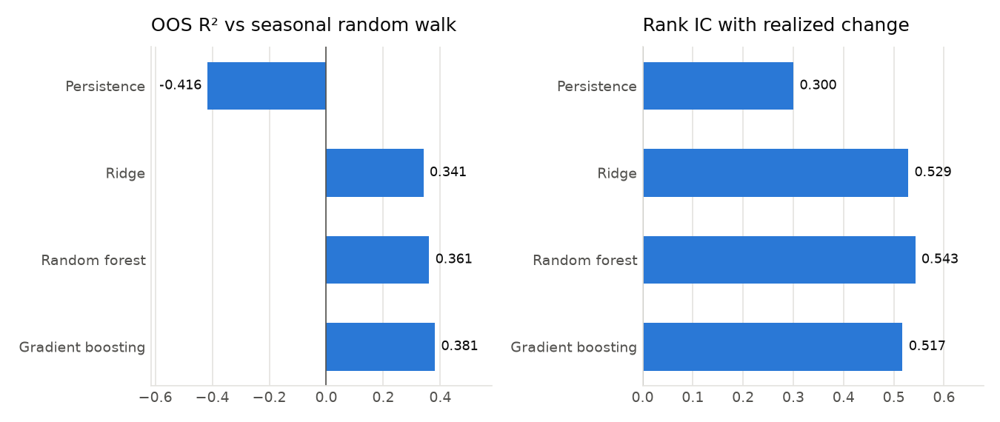
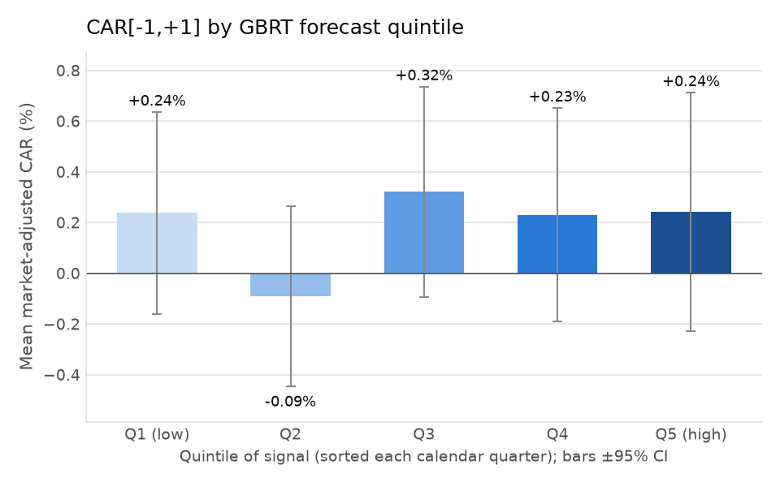
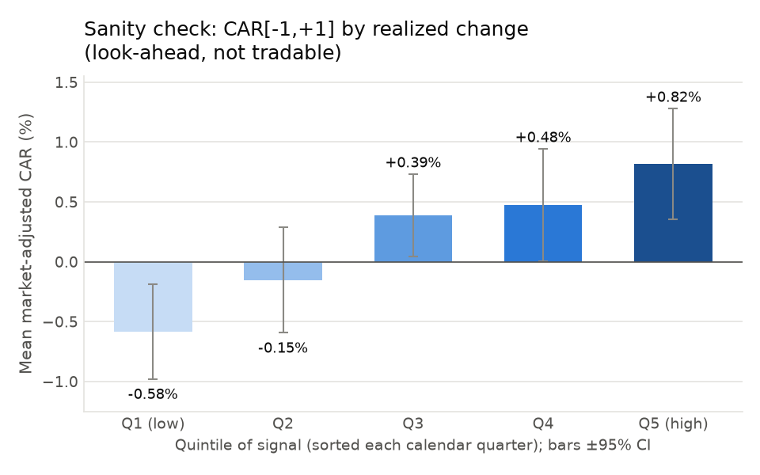
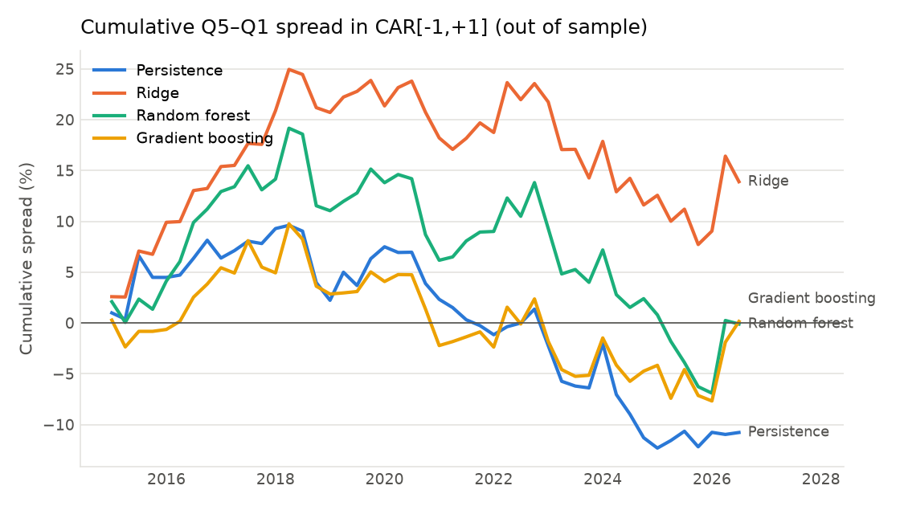

# Do ML forecasts of firm profitability predict stock returns around earnings announcements?

A reproducible research pipeline built entirely on **free data**: SEC EDGAR
(XBRL fundamentals + 8-K earnings-release timestamps) and Yahoo Finance daily prices.

## Short answer (from this repo's actual run, 21 Oct 2026)

| | Result |
|---|---|
| Can ML forecast next-quarter profitability changes? | **Yes.** Gradient boosting: out-of-sample R² = **0.38** vs. the seasonal random walk; mean quarterly rank IC = **0.52** (t = 21.8). |
| Do those forecasts predict announcement returns, CAR[-1,+1]? | **No.** Q5–Q1 spread = **0.00%** (t = 0.01) for gradient boosting; +0.30% (t = 0.83) for ridge. Fama–MacBeth slopes are insignificant with or without controls. |
| Post-announcement drift, CAR[+2,+21]? | **No.** All forecast-sorted spreads have \|t\| < 1. |
| Is the event study wired correctly? | **Yes (look-ahead check).** Sorting on the *realized* earnings change gives a **+1.40%** spread (t = 4.1). Sorting on realized-minus-ML-forecast gives **+1.73%** (t = 6.3). |

**Interpretation.** The predictable part of earnings is already in prices before
the announcement. Returns respond to the part the model *could not* forecast, and
the ML-unexpected component explains announcement returns better than the naive
surprise does. So the ML forecast behaves like a decent proxy for market
expectations, not a source of mispricing. This holds in this sample of 92 current
mega-caps, 2015–2026. Mega-caps are heavily covered by analysts, which is exactly
where you'd expect this result. The null may not carry over to small caps.



| Forecast-sorted (out of sample) | Realized-change sanity check (look-ahead) |
|---|---|
|  |  |



## Research design

**Unit of observation:** firm × fiscal quarter *q*, evaluated at the moment just before quarter *q*'s earnings release.

**Target (profitability change):** `y = (NI_q − NI_{q−4}) / Assets_{q−1}`. This is the seasonal
change in quarterly net income, scaled by assets. The seasonal random walk forecasts `y = 0`.

**Earnings announcement dates:** the first 8-K containing **Item 2.02** (*Results of
Operations*) filed within 75 days after the fiscal quarter end. Its EDGAR acceptance time decides the
event day: at or after 16:00 ET, the event is assigned to the next trading session.
> The submissions API's `acceptanceDateTime` is **not** the true acceptance time. It is shifted by twice
> the Eastern UTC offset. I verified this by hand against EDGAR filing-index pages and corrected it in
> `sec.api_time_to_eastern`, with a regression test that uses those hand-checked values.

**Features (17, all point-in-time):**
- lagged scaled earnings `ni_l1..ni_l5`
- past seasonal changes `de_l1, de_l2, de_l4`
- revenue growth, operating margin, leverage, log assets, loss indicator
- 3- and 12-month momentum and 3-month volatility, measured through day −2
- the previous announcement's CAR

Each accounting value is the **first-filed** XBRL value, so later restatements are ignored. A
quarter's numbers are only used if their filing was accepted before the release being forecast;
otherwise those features are blanked. Fourth quarters are derived as FY minus the 9-month YTD
value, dated at the 10-K filing date.

**Models:**
- persistence benchmark (`ŷ = de_l1`)
- RidgeCV
- random forest
- histogram gradient boosting (scikit-learn)

Training uses an **expanding window**: for test year *Y*, models are fit only on firm-quarters whose
realized earnings were filed before 1 Jan *Y*. Winsorization (1/99%), imputation and scaling are
fit on the training window only.

**Return tests:**
- market-adjusted CAR (stock − SPY) over [−1,+1] and [+2,+21]
- quintile sorts within each calendar quarter, with a Newey–West t-stat on the 47 quarterly Q5–Q1 spreads
- Fama–MacBeth regressions on rank-scaled regressors, with controls for the persistence signal, momentum and size

## Full results

`results/forecast_accuracy.csv`. N = 4,082 out-of-sample firm-quarters, Jan 2015 – Oct 2026.

| model | OOS R² vs seasonal RW | OOS R² vs persistence | MAE | rank IC | IC t |
|---|---:|---:|---:|---:|---:|
| persistence | −0.416 | 0.000 | 0.0114 | 0.300 | 14.6 |
| ridge | 0.341 | 0.534 | 0.0078 | 0.529 | 23.4 |
| random forest | 0.361 | 0.549 | 0.0075 | 0.543 | 28.4 |
| gradient boosting | **0.381** | **0.563** | **0.0074** | 0.517 | 21.8 |

`results/long_short_returns.csv`: mean CAR (%) by quintile, sorted each calendar quarter (47 quarters).

| signal | window | Q1 | Q3 | Q5 | Q5–Q1 | NW t | hit rate |
|---|---|---:|---:|---:|---:|---:|---:|
| persistence | [−1,+1] | 0.35 | 0.22 | 0.12 | −0.23 | −0.78 | 45% |
| ridge | [−1,+1] | 0.02 | 0.25 | 0.32 | 0.30 | 0.83 | 57% |
| random forest | [−1,+1] | 0.11 | 0.02 | 0.10 | −0.00 | −0.01 | 53% |
| gradient boosting | [−1,+1] | 0.24 | 0.32 | 0.24 | 0.00 | 0.01 | 53% |
| *realized change (look-ahead)* | [−1,+1] | −0.58 | 0.39 | 0.82 | 1.40 | 4.11 | 68% |
| *realized − GBRT forecast (look-ahead)* | [−1,+1] | −0.71 | 0.11 | 1.02 | 1.73 | 6.30 | 79% |
| gradient boosting | [+2,+21] | 0.33 | 0.23 | 0.32 | −0.02 | −0.04 | 53% |
| *realized − GBRT forecast (look-ahead)* | [+2,+21] | 0.03 | 0.06 | 0.70 | 0.67 | 2.11 | 64% |

Fama–MacBeth (`results/fama_macbeth.csv`), CAR[−1,+1]:
- GBRT forecast: coefficient 0.09%, t = 0.25 (with controls)
- ridge forecast: coefficient 0.47%, t = 1.21 (with controls)

Permutation importance (`results/feature_importance.png`) is dominated by `ni_l4`. Last year's
same-quarter earnings level mean-reverts, which is the classic source of earnings predictability.

## Reproduce

```bash
python3 -m venv .venv
```
```bash
.venv/bin/pip install -e ".[dev]"
```
```bash
export SEC_USER_AGENT="Your Name your.email@example.com"
```
```bash
.venv/bin/python -m earnml.pipeline --stage all
```
```bash
.venv/bin/python -m pytest -q
```

A full run takes ~2 minutes after the first download. Raw downloads are cached under `data/`,
which is gitignored. Stages can be run separately with `--stage data|model|evaluate`. Use
`--tickers AAPL MSFT ...` for a quick subset.

## Repository layout

```
config/universe.txt        tickers (current S&P 100 members)
src/earnml/sec.py          EDGAR client, 8-K Item 2.02 release times, point-in-time XBRL quarters
src/earnml/prices.py       Yahoo Finance adjusted closes (yfinance), cached
src/earnml/events.py       release -> event-day mapping, market-adjusted CARs
src/earnml/features.py     firm-quarter panel: target, lagged features, look-ahead guards
src/earnml/models.py       expanding-window training: persistence, ridge, RF, gradient boosting
src/earnml/evaluation.py   OOS R², rank IC, quintile sorts, Newey-West, Fama-MacBeth
src/earnml/plots.py        figures in results/figures/
src/earnml/pipeline.py     CLI entry point
tests/                     18 unit tests (timestamp fix, Q4 derivation, no-look-ahead checks, model/eval sanity)
results/                   committed outputs from the run reported above
```

## Limitations and data-access caveats (read before citing)

1. **Survivorship bias.** The universe is *today's* S&P 100, and free sources do not cover
   delisted firms well. Firms that failed, were acquired or dropped out are missing. This mainly
   affects the return tests' generality. Proper work needs CRSP/Compustat (WRDS access) or a
   point-in-time constituent list.
2. **Small, mega-cap-only sample.** 92 firms × ~45 quarters gives ~90 events per cross-section and
   ~18 per quintile, so power is limited. A spread of about ±0.3% cannot be distinguished from zero here.
3. **No analyst consensus.** IBES/Zacks consensus is not free. The surprise benchmark is the
   seasonal random walk, not the street estimate. A stronger test would ask whether ML forecasts
   predict returns *relative to* consensus.
4. **Event timing.** The event date is the 8-K acceptance time. If a press release goes out
   pre-market and the 8-K is filed after the close, the event is assigned one day late. The
   [−1,+1] window absorbs most of that.
5. **Market-adjusted returns only** (stock − SPY). There is no beta or characteristic adjustment,
   and no transaction costs, because nothing here is a trading strategy.
6. **Data vendors.** yfinance is an unofficial Yahoo API, and its adjusted prices can be revised.
   XBRL tagging varies by firm. Revenue falls back through five tags, and operating income is
   missing for most banks.
7. **CIK changes.** Holding-company reorganizations (XOM, BLK, DIS, GOOGL, MDT) are handled by
   merging predecessor CIKs, listed and verified in `config.py`. BK was dropped because neither
   SEC nor Yahoo resolves the ticker. ABBV starts in 2013 and LIN in 2018.
